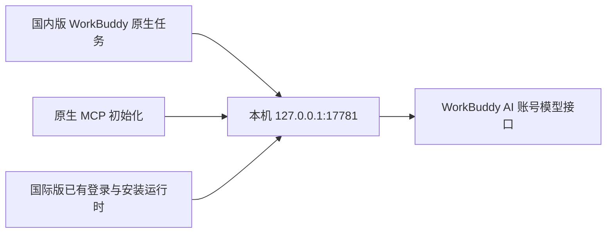

# WorkBuddy AI Connector Skill

在 **国内版 WorkBuddy** 中使用本机已登录的 **WorkBuddy AI 国际账号对话模型**。保留国内版的原生任务界面、模型选择器和文件工具；日常只打开国内版，后台连接组件随原生 MCP 启动，并跟随桌面进程退出。

本项目是非官方 Windows 本机适配。需要本机已有两个客户端和有效的国际版登录，不需要再部署 AI 服务，也不需要下载模型权重。代码只使用 Node.js 内置模块及本机已安装客户端的能力，不分发任何客户端二进制。

## 直接复制给 WorkBuddy

打开**国内版 WorkBuddy**，新建一个任务，完整复制下面这段话发送。它包含仓库、固定版本和部署要求，不需要自己填写安装路径或编写命令。

```text
请帮我安装并部署这个 Skill，让我直接在国内版 WorkBuddy 中使用我已登录的 WorkBuddy AI 国际账号对话模型。

仓库：https://github.com/yukunchen222-cloud/workbuddy-ai-connector-skill
版本：v0.2.0
固定源码提交：bced96e403ec636995eaedb1e5715343f1938d04
安装包：https://github.com/yukunchen222-cloud/workbuddy-ai-connector-skill/releases/download/v0.2.0/workbuddy-ai-connector.zip
安装包 SHA-256：e1152142513a41090b725a3af4834cb8bb6ce2b1ce83c3b330e22a557935f175

请先阅读 README.md 和 SKILL.md，按当前环境的来源审查规则检查脚本，下载并校验这个固定版本，再通过当前 WorkBuddy 支持的方式安装 Skill。审查不通过就说明原因，不绕过安全规则。

自动查找并核对本机国内版 WorkBuddy.exe、国际版 WorkBuddyAI.exe 的真实位置与版本。确实找不到客户端或需要登录时，再告诉我具体要完成哪一步，不要让我填写示例路径。

按照 Skill 执行 setup.ps1 的 check；成功后继续 install。保留其他模型和 MCP 配置，使用本机已有的国际版运行时，不另外部署 AI。若已安装这个连接组件，先检查现状，需要时再更新，避免重复配置。

模型名称使用“原模型名 · WorkBuddy AI”，自定义组内免费优先；支持 1M 的模型默认 1M，其他模型保留真实上限。

最后检查连接状态，并用一个当前可用的模型完成真实短回复测试，报告模型数量、默认 1M 数量和测试结果。不能只凭脚本成功就说已经可用。

检查通过后直接继续必要的安装步骤，不必每步向我确认。需要我登录、确认原生 MCP 信任或处理系统审批时，再明确告诉我在哪里操作；如需重开客户端，先让我保存当前任务。无法自动操作的界面步骤请具体交接。
```

首次使用可能需要你**登录国际版、确认原生 MCP 信任**，按实际提示完成即可。如果当前 WorkBuddy 版本不能自动导入 Skill，让它交付已校验的 ZIP 和具体操作位置，再按下方“手动导入 Skill”操作。是否部署成功，以连接检查和真实测试回复为准；不同版本对上述自然语言安装流程的自动化程度尚未逐一验收。

已经导入 Skill 时，可用更短的提示词：

```text
使用 workbuddy-ai-connector，检查本机现有连接；尚未配置时按 Skill 完成部署，已经配置时不要重复安装。请检查模型目录和上下文设置，并用可用模型完成一次真实短回复验证。支持 1M 的模型默认设为 1M，最后报告检查结果。
```

## 已完成与实际验证

截至 **2026-10-15**，在国内版 **5.6.2**、国际版 **5.7.6** 上验证：

| 能力 | 结果 |
| --- | --- |
| 读取账号真实模型目录 | 27 个模型，其中 25 个对话模型、2 个图片/视频模型 |
| 原生对话模型接入 | 25 个对话模型已注册；并非 25 个都已逐一调用验收 |
| 模型名称 | `原模型名 · WorkBuddy AI`，同名 SG 通道单独标注 |
| 积分与排序 | 显示目录倍率，自定义组内零积分模型优先 |
| 上下文 | 16 个支持 1M 的模型默认 1M；其余 9 个保留真实上限；原有多档选择保留 |
| 原生回复 | Deepseek 精确字符串回复通过 |
| 文件工具 | Deepseek 在国内版调用原生 PowerShell 复制测试文件，独立核对 SHA-256 和字节完全一致 |
| 自动启动与退出 | 国内版正常打开后自动启动连接，正常退出后连接清理通过 |
| 1M 设置 | 原生 300K / 1M 切换通过；真实短回复后，会话预算显示 `37.4K / 1000.0K` |

**没有宣称完成的部分：** 图片/视频生成接入、所有模型复杂任务稳定性、满 1M 输入压力测试、整个模型菜单跨分组的免费排序。Step-5 简单回复通过，但一次复杂文件任务出现上游 500，并多写一个换行，该模型复杂任务验收仍未通过。国内版知识库、云部署及市场资产与自定义模型的所有组合也未逐项验证。

模型数、免费活动与账号权限会变化。免费优先是目录排序，不会改变计费或绕过配额。细节见 [验证记录](references/validation.md)。

## 手动导入 Skill

1. [下载 v0.2.0 Skill 安装包](https://github.com/yukunchen222-cloud/workbuddy-ai-connector-skill/releases/download/v0.2.0/workbuddy-ai-connector.zip)，先审阅来源、脚本和权限，并核对[版本说明与校验值](https://github.com/yukunchen222-cloud/workbuddy-ai-connector-skill/releases/tag/v0.2.0)。
2. 在国内版“专家·技能·连接器 → 技能 → 添加技能 → 上传技能”导入 ZIP。
3. 输入：**“使用 workbuddy-ai-connector，检查我的两个 WorkBuddy 安装位置，把国际账号的对话模型接入国内版。”**
4. 根据原生提示信任 MCP `workbuddy-ai-connector`，新建任务，在模型菜单选择带 `· WorkBuddy AI` 的模型。

WorkBuddy 官方文档说明了[本地技能包导入](https://www.codebuddy.cn/docs/workbuddy/From-Beginner-to-Expert-Guide/Function-Description/Skills-Market)。本仓库发布到 GitHub 不等于已上架 WorkBuddy 技能市场；本次发布也不等于已在其他机器或账号完成导入验收。

支持 Codex 时，也可把审阅后的完整目录放入其 Skills 目录，再调用 `$workbuddy-ai-connector`。Skill 是操作说明与脚本包，安装模型连接还需要下面的配置步骤。

## 手动配置：先检查，再安装

前提：Windows；已安装国内版和国际版；国际版已正常登录。先找到两个 `.exe` 的实际位置。下例的路径需要替换成你自己的安装位置，脚本默认只检查：

```powershell
& '.\scripts\setup.ps1' -WorkBuddyExe 'C:\Apps\WorkBuddy\WorkBuddy.exe' -WorkBuddyAIExe 'C:\Apps\WorkBuddyAI\WorkBuddyAI.exe' -Action check
```

看到 `success=true`、`localKeyRoundtripPassed=true` 后安装：

```powershell
& '.\scripts\setup.ps1' -WorkBuddyExe 'C:\Apps\WorkBuddy\WorkBuddy.exe' -WorkBuddyAIExe 'C:\Apps\WorkBuddyAI\WorkBuddyAI.exe' -Action install
```

脚本使用国际版自带运行时，无需另外安装 Node.js 来运行此安装流程。若本机 PowerShell 策略禁止脚本运行，应按你的环境要求处理；这里不提供绕过策略的一键命令。

安装成功后，在原生界面信任 MCP。如果客户端需要重新加载，正常重开即可。新建任务，选择例如 `Deepseek-V4.1-Flash · WorkBuddy AI`，发送简短测试。鼠标移到模型条目，可查看并切换它实际支持的上下文档位。

刷新账号模型目录：再次运行 `check`、`install`。不承诺静态模型名称永久可用；模型权限与消费始终由国际服务决定。

## 数据与配置范围



- 读取本机国际版已有登录，访问令牌与刷新令牌只在内存使用，不写入本项目、模型配置、日志或自建账号缓存。
- 请求正文会发往 `https://www.workbuddy.ai`。模型返回内容交还国内版，仍受服务端账号权限与限制控制。
- 仅监听 `127.0.0.1:17781`，拒绝网页 Origin；模型接口需要独立本机连接密钥。
- 写入 `%USERPROFILE%\.workbuddy\models.json`、`mcp.json` 中的本组件条目。原配置备份、非秘密模型目录、运行时代码及状态日志放在 `%LOCALAPPDATA%\WorkBuddyAIConnector`。
- 原配置备份可能包含用户原有模型密钥，**仅留本机，不要上传整个状态目录或完整配置**。
- 安装时按原生凭证模块加密本机连接密钥，已观察到国内版之后会按自身策略改写为本地明文，因此不能保证它始终加密。它不等于国际账号令牌。
- 本版日志只写模型标识、状态码、耗时、计数及启动状态，不保存对话正文或上游自由文本错误。不要为排障输出认证文件、令牌或完整配置。

依赖 `/v3/config`、`/v2/chat/completions` 和客户端内部凭证格式；它们不是本项目拥有稳定性承诺的公开 API。客户端更新后先检查，再做一次真实原生回复验收。实现说明见 [architecture.md](references/architecture.md)。

## 卸载

```powershell
& '.\scripts\setup.ps1' -WorkBuddyExe 'C:\Apps\WorkBuddy\WorkBuddy.exe' -WorkBuddyAIExe 'C:\Apps\WorkBuddyAI\WorkBuddyAI.exe' -Action remove
```

然后正常关闭、打开国内版。只移除本组件的模型与 MCP 配置；保留其他模型、项目、会话、日志、备份和运行时代码。不要用旧备份整份覆盖后来新增的配置。

## 开发验证

开发检查需要 Node.js 22 或更高版本；运行连接组件本身使用国际版已有运行时。

```powershell
node --test
node scripts/check-package.cjs
```

单元检查覆盖配置保留、移除范围、免费排序、上下文上限、旧模型编号和配置写入回滚。它们不替代真实客户端验收。

前期调研由 [corrinehu/dsh-workbuddy-connect](https://github.com/corrinehu/dsh-workbuddy-connect) 引出，本发布包整理的是本机验证过程中编写的适配脚本。WorkBuddy 与 WorkBuddy AI 的名称、客户端和服务属于各自权利人，本项目与其没有官方关联。

MIT License，见 [LICENSE](LICENSE)。
